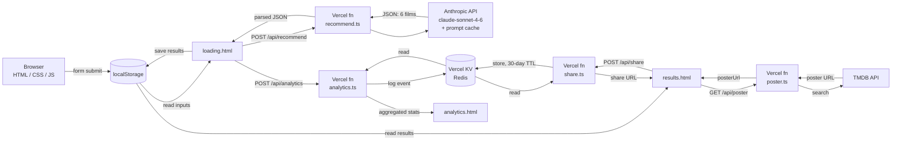

# CineMatch

Describe your mood, choose a genre, and name the occasion. CineMatch returns six films with spoiler-free explanations.

**Live:** https://cinematch-navy.vercel.app
**Repository:** https://github.com/jeffzh4/Cinematch

---

## How it works

1. Answer three questions; optionally filter by runtime, decade, or platform.
2. A Vercel function calls Claude for six films and a headline as JSON.
3. Results display explanations and TMDB posters. Films can be saved locally or shared.
4. Failed recommendations open an error page.

Analytics stores submitted preferences and timestamps without account identifiers. The public dashboard shows counts and recent mood and occasion text. Shared recommendations expire after 30 days.

---

## Pages

| Page | Function |
|---|---|
| `index.html` | Landing |
| `form.html` | Three required questions, three optional filters |
| `loading.html` | Requests recommendations |
| `results.html` | Recommendations, posters, sharing |
| `favorites.html` | Films saved in this browser |
| `share.html` | Read-only shared results (`?id=`) |
| `analytics.html` | Usage totals, genres, moods, occasions |
| `error.html` | Failure state |
| `404.html` | Not-found state |
| `about.html`, `contact.html` | Supporting pages |

## API routes

| Endpoint | Function |
|---|---|
| `POST /api/recommend` | Accepts `{ mood, genres, occasion, runtime?, decade?, platforms? }`, returns recommendation JSON |
| `GET /api/poster?title=&year=` | Resolves poster art via TMDB |
| `POST /api/analytics` | Logs an anonymized usage event |
| `GET /api/analytics` | Returns aggregated usage statistics |
| `POST /api/share` | Stores results, returns a share link |
| `GET /api/share?id=` | Retrieves shared results |
| `/api/share-og` | Serves crawler metadata for a shared list |
| `/api/share-image?id=` | Generates a preview image for a shared list |

TypeScript endpoints read credentials from server environment variables; keys never reach the browser.

---

## Architecture



Favorites and current results stay in browser storage. Analytics and shares use Vercel KV.

---

## Local Development

1. Install the Vercel CLI: `npm i -g vercel`
2. Create `.env.local`:
   ```
   ANTHROPIC_API_KEY=sk-ant-...
   TMDB_API_KEY=...
   KV_REST_API_URL=...
   KV_REST_API_TOKEN=...
   ```
3. Run `vercel dev` and open the printed URL.

Local development uses the production API routes.

### Checks before opening a pull request

Run `npm ci` from the repository root, then:

- `npm test` runs the Node test suite. API tests mock KV requests; the share image regression test also renders a PNG using the installed renderer.
- `npm run check` checks page metadata, accessibility conventions, contrast tokens, and common credential exposure patterns in static HTML.

These checks require no provider credentials. They do not exercise the full recommendation flow in a browser.

---

## Deployment

1. Push the repository to GitHub.
2. Import the repository into Vercel.
3. Set environment variables: `ANTHROPIC_API_KEY`, `TMDB_API_KEY`, and optionally `ANTHROPIC_MODEL` (defaults to `claude-sonnet-4-6`).
4. Deploy. Vercel detects static assets and serverless functions automatically.

### Vercel KV (required for analytics and share links)

1. In the Vercel dashboard: **Storage → Create Database → KV**, connect it to the project.
2. `KV_REST_API_URL` and `KV_REST_API_TOKEN` are added automatically.
3. Redeploy.

---

## Stack

- HTML/CSS/vanilla JS on the client — no framework, no build step
- TypeScript serverless functions
- Claude (`claude-sonnet-4-6`) with prompt caching
- TMDB poster art
- Vercel KV (Redis) for analytics and share-link storage
- Vercel for hosting and serverless compute

See [CASE_STUDY.md](./CASE_STUDY.md) for decisions and trade-offs.

Built by Jeffrey Zhang, 2026.
