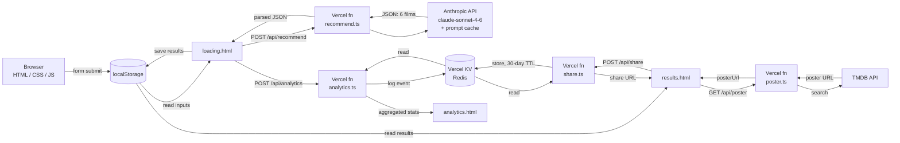

# CineMatch

Describe your mood, choose a genre, and name the occasion. CineMatch returns six films with spoiler-free explanations.

**Live:** https://cinematch-navy.vercel.app
**Repository:** https://github.com/jeffzh4/Cinematch

---

## How it works

1. Answer three questions; optionally filter by runtime, decade, or platform.
2. A Vercel function calls Claude for six films and a headline as JSON.
3. Results display explanations and TMDB posters. Films can be saved locally or shared.
4. Failed recommendations open an error page.

The public analytics page includes submitted mood and occasion text, filters, and timestamps, without account details. Shared recommendations expire after 30 days.

---

## Pages

| Page | Function |
|---|---|
| `index.html` | Landing |
| `form.html` | Intake — three required questions, three optional filters |
| `loading.html` | Recommendation request in flight |
| `results.html` | Recommendation output, poster art, share action |
| `favorites.html` | Films saved in this browser |
| `share.html` | Read-only view of a shared result set (`?id=`) |
| `analytics.html` | Aggregate usage dashboard — genre distribution, mood/occasion trends |
| `error.html` | Failure state |
| `404.html` | Not-found state |
| `about.html`, `contact.html` | Supporting pages |

## API routes

| Endpoint | Function |
|---|---|
| `POST /api/recommend` | Accepts `{ mood, genres, occasion, runtime?, decade?, platforms? }`, returns structured recommendation JSON |
| `GET /api/poster?title=&year=` | Resolves poster art via TMDB |
| `POST /api/analytics` | Logs an anonymized usage event |
| `GET /api/analytics` | Returns aggregated usage statistics |
| `POST /api/share` | Persists a result set, returns a share link |
| `GET /api/share?id=` | Retrieves a persisted result set |
| `/api/share-og` | Serves crawler metadata for a shared list |
| `/api/share-image?id=` | Generates a preview image for a shared list |

TypeScript endpoints read credentials from server environment variables; keys never reach the browser.

---

## Architecture



Favorites and current results stay in browser storage. Analytics and shares use Vercel KV.

---

## Local Development

1. Install the Vercel CLI: `npm i -g vercel`
2. Create `.env.local`:
   ```
   ANTHROPIC_API_KEY=sk-ant-...
   TMDB_API_KEY=...
   KV_REST_API_URL=...
   KV_REST_API_TOKEN=...
   ```
3. Run `vercel dev` and open the printed URL.

Local development uses the production API routes.

---

## Deployment

1. Push the repository to GitHub.
2. In Vercel, import the repository as a new project.
3. Set environment variables: `ANTHROPIC_API_KEY`, `TMDB_API_KEY`, and optionally `ANTHROPIC_MODEL` (defaults to `claude-sonnet-4-6`).
4. Deploy. Static assets and serverless functions are detected automatically — no build configuration required.

### Vercel KV (required for analytics and share links)

1. In the Vercel dashboard: **Storage → Create Database → KV**, connect it to the project.
2. `KV_REST_API_URL` and `KV_REST_API_TOKEN` are added automatically.
3. Redeploy.

---

## Stack

- HTML/CSS/vanilla JS on the client — no framework, no build step
- TypeScript serverless functions
- Claude (`claude-sonnet-4-6`) with prompt caching
- TMDB poster art
- Vercel KV (Redis) for analytics and share-link storage
- Vercel for hosting and serverless compute

See [CASE_STUDY.md](./CASE_STUDY.md) for implementation decisions and remaining trade-offs.

Built by Jeffrey Zhang, 2026.
